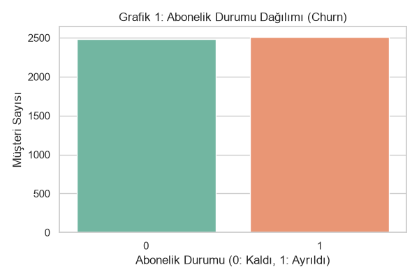
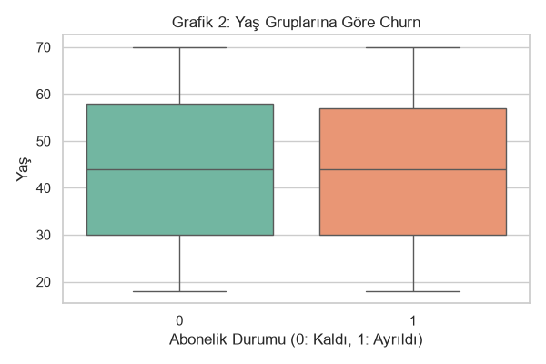
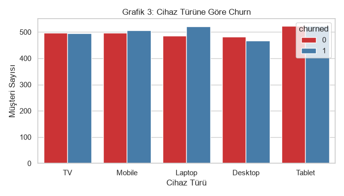
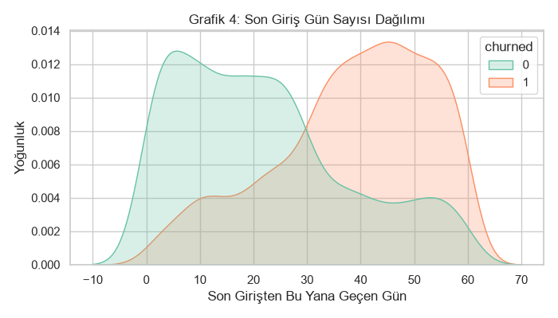
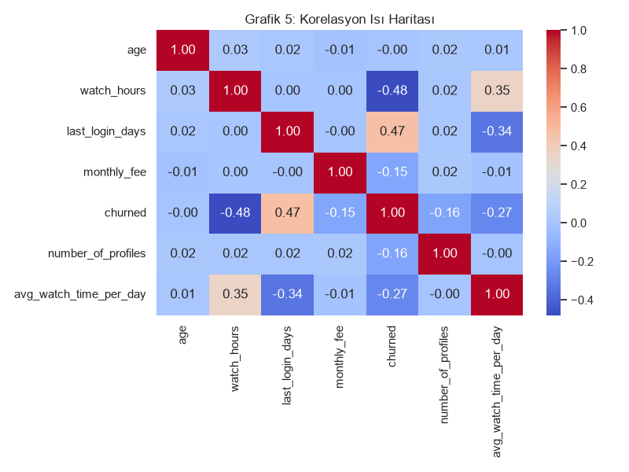

# Netflix Customer Churn Analizi ve Modelleme Raporu

---

## 1. AŞAMA: VERİYİ TANIMA VE KEŞİFSEL VERİ ANALİZİ (EDA)

### 1.1 Projenin Amacı ve İş Problemi
Bu projenin temel amacı, Netflix kullanıcılarının platformu kullanmayı bırakma (Churn) eğilimlerini makine öğrenmesi yöntemleriyle önceden tahmin etmektir. Müşteri tutundurma (retention) maliyetinin yeni müşteri kazanma maliyetine kıyasla çok daha düşük olması sebebiyle, aboneliğini sonlandırma riski taşıyan kullanıcıların tespit edilmesi işletme açısından kritik bir öneme sahiptir.

### 1.2 Veri Seti Yapısı ve Boyutu
Analizde kullanılan **Netflix Customer Churn** veri seti toplam **5.000 satır (müşteri kaydı)** ve **14 sütun (öznitelik)** içermektedir. Veri setinde yer alan sütunlar ve veri tipleri şu şekildedir:

* **Sayısal Değişkenler:** `age` (Yaş), `monthly_fee` (Aylık Ücret), `watch_hours_per_week` (Haftalık İzleme Saati), `last_login_days` (Son Girişten Bu Yana Geçen Gün) ve hedef değişken olan `churned`.
* **Kategorik Değişkenler:** `gender` (Cinsiyet), `subscription_type` (Abonelik Türü), `region` (Bölge), `device` (Kullanılan Cihaz), `payment_method` (Ödeme Yöntemi) ve `favorite_genre` (Favori Tür).
* **Kimlik Değişkeni:** `customer_id` (Benzersiz Müşteri Kimliği).

### 1.3 Hedef Değişken (`churned`) Dağılım Analizi
Modelin tahmin etmeye çalışacağı hedef değişken (`churned`), müşterinin aboneliğini sonlandırıp sonlandırmadığını temsil eden ikili (binary) bir değişkendir:

* **1 (Churned - Ayrılan):** 2.515 müşteri (%50.3)
* **0 (Retained - Kalan):** 2.485 müşteri (%49.7)

#### EDA Değerlendirmesi:
1. **Sınıf Dengesi (Class Balance):** Veri setinde sınıf dağılımı neredeyse tam olarak yarı yarıyadır (%50.3 - %49.7). Veri setimiz **tam dengeli (balanced)** bir yapıya sahip olduğu için, SMOTE veya sınıf ağırlıklandırma gibi ekstra tekniklere ihtiyaç duyulmamıştır.
2. **Model Değerlendirme Odak Noktası:** Sınıf dengeli olmasına rağmen, iş problemi gereği sınıflandırma başarısını değerlendirirken yalnızca Doğruluk (Accuracy) oranına değil, Yanlış Negatifleri (False Negative) minimize eden Duyarlılık (Recall) metriğine odaklanılacaktır.

---

## 2. AŞAMA: VERİ TEMİZLEME VE ÖN İŞLEME

### 2.1 Eksik ve Gereksiz Veri Analizi
* **Eksik Değerler (Missing Values):** Veri seti genelinde yapılan kontrolde hiçbir sütunda eksik veya hatalı değer bulunmamıştır.
* **Gereksiz Sütunların Kaldırılması:** Modellenmeye katkı sağlamayan ve tahmin başarısını olumsuz etkileyebilecek benzersiz kimlik sütunu olan `customer_id` veri setinden çıkarılmıştır.

### 2.2 Kategorik Verilerin Dönüştürülmesi (One-Hot Encoding)
Makine öğrenmesi algoritmalarının metin tabanlı verileri işleyebilmesi için kategorik sütunlara **One-Hot Encoding** işlemi uygulanmıştır. Kukla değişken tuzağından (dummy variable trap) kaçınmak adına `drop_first=True` parametresi kullanılmıştır.

Dönüştürülen kategorik sütunlar: `gender`, `subscription_type`, `region`, `device`, `payment_method`, `favorite_genre`.

### 2.3 Veri Ölçekleme (Standardization)
Özellikle mesafe ve katsayı tabanlı çalışan **Logistic Regression** modelinin performansını artırmak amacıyla sayısal değişkenlere `StandardScaler` uygulanarak verilerin ortalaması 0, standart sapması 1 olacak şekilde ölçeklenmiştir. Karar Ağacı (Decision Tree) modeli kural tabanlı çalıştığı için bu ölçeklemeden etkilenmemektedir.

---

## 3. AŞAMA: GÖRSELLEŞTİRME VE BULGULAR

Veri setindeki değişkenlerin hedef değişken ile ilişkilerini kavrayabilmek adına 5 ana görselleştirme hazırlanmıştır:

---
### Grafik 1: Abonelik Durumu Dağılımı (Churn)

**Yorum:**
Veri setinde aboneliğini iptal eden (1) ve devam ettiren (0) müşteri sayıları sırasıyla 2515 ve 2485'tir. Veri kümesi %50-%50 oranında ideal bir denge sergilemektedir.

---
### Grafik 2: Yaş Gruplarına Göre Churn Durumu

**Yorum:**
Kalan ve ayrılan müşterilerin kutu grafiklerindeki yaş ortalamaları ve çeyreklik dağılımları oldukça benzerdir. Bu durum, yaş değişkeninin tek başına abonelik iptalini belirlemede baskın bir etkisi olmadığını göstermektedir.

---
### Grafik 3: Cihaz Türüne Göre Churn Dağılmı

**Yorum:**
TV, Mobil, Laptop ve Tablet kullanıcıları arasında ayrılan ve kalan oranları birbirine yakındır. Platforma erişim sağlanan cihaz türünün müşteri kaybı üzerinde doğrudan belirleyici bir etkisi olmadığı görülmektedir.

---
### Grafik 4: Son Girişten Bu Yana Geçen Gün Sayısı Dağılımı
 

**Yorum:**
Platforma en son ne zaman giriş yapıldığını gösteren gün sayısının yoğunluk dağılımı her iki grupta da geniş bir yelpazeye yayılmaktadır.

---
### Grafik 5: Sayısal Değişkenlerin Korelasyon Matrisi

**Yorum:**
Sayısal özellikler arasındaki korelasyon katsayıları 0'a yakın değerler almaktadır. Değişkenler arasında yüksek doğrusal bağımlılık (multicollinearity) bulunmaması, modellerin daha kararlı çalışmasını sağlamaktadır.

---

## 4. VE 5. AŞAMA: MODELLEME, DEĞERLENDİRME VE İŞ ANALİZİ

### 4.1 Train / Test Ayrımı
Veri seti, aşırı öğrenmeyi (overfitting) önlemek ve genelleyebilirliği ölçmek amacıyla **%80 Eğitim (Train)** ve **%20 Test** seti olarak ikiye bölünmüştür. Hedef değişken oranının her iki sette de korunması için `stratify=y` yöntemi kullanılmıştır.

* **Eğitim Seti:** 4.000 örneklem
* **Test Seti:** 1.000 örneklem

### 4.2 Model Performans Karşılaştırılması

Eğitilen **Logistic Regression** ve **Decision Tree (Karar Ağacı)** modellerinin test seti üzerindeki başarı metrikleri aşağıdaki tabloda sunulmuştur:

| Model | Accuracy (Doğruluk) | Precision (Kesinlik) | Recall (Duyarlılık) |
| :--- | :---: | :---: | :---: |
| **Logistic Regression** | %88.70 | %87.50 | %90.45 |
| **Decision Tree (Karar Ağacı)** | **%92.60** | **%94.04** | **%91.05** |

#### Karmaşıklık Matrisleri (Confusion Matrix):

* **Logistic Regression:**
  * True Negative (Kalanı Bildi): 432
  * False Positive (Yanlış Ayrılacak Dedi): 65
  * False Negative (Kaçırdığı Churn): 48
  * True Positive (Ayrılanı Bildi): 455

* **Decision Tree:**
  * True Negative (Kalanı Bildi): 468
  * False Positive (Yanlış Ayrılacak Dedi): 29
  * False Negative (Kaçırdığı Churn): 45
  * True Positive (Ayrılanı Bildi): 458

### 4.3 İş Analizi ve Değerlendirme (Kritik Soru)

#### Soru: *Bu problemde yanlış 'hayır' (False Negative) demek mi daha kötü, yanlış 'evet' (False Positive) demek mi? Neden?*

**Yanıt ve İş Analizi:**
* **Yanlış 'Hayır' Demek (False Negative / Type II Error):** Müşteri aslında aboneliğini iptal edecektir (`1`), ancak model onun kalacağını (`0`) tahmin eder. Bu durumda şirket, ayrılacak müşteriyi tespit edemediği için ona özel tutundurma kampanyası (indirim, e-posta teklifi vb.) sunamaz ve **müşteriyi tamamen kaybeder**.
* **Yanlış 'Evet' Demek (False Positive / Type I Error):** Müşteri aslında platformda kalacaktır (`0`), ancak model onun ayrılacağını (`1`) tahmin eder. Şirket bu müşteriye boş yere indirim kuponu tanımlar. Bunun şirkete maliyeti yalnızca küçük bir pazarlama indirimidir.

**Sonuç:**
Müşteri tutma (Churn) senaryolarında **Yanlış 'Hayır' demek (False Negative) çok daha zararlıdır ve maliyeti yüksektir.** Bir müşteriyi kaybetmenin maliyeti, mevcut sadık bir müşteriye yanlışlıkla indirim teklif etmenin maliyetinden katkat fazladır. Bu nedenle, model seçiminde ve değerlendirmesinde **Recall (Duyarlılık)** metriği öncelikli kriter olarak belirlenmiştir.

### 5. Genel Sonuç ve Öneriler
1. **Kazanan Model:** **Decision Tree** modeli, %92.60 Doğruluk (Accuracy) ve %91.05 Duyarlılık (Recall) oranları ile tüm kriterlerde en yüksek başarımı göstererek en iyi model olarak seçilmiştir.
2. **Aksiyon Önerisi:** Şirket, Decision Tree modelinin "Churn riski yüksek" olarak işaretlediği müşterilere otomatik olarak tutundurma kampanyaları tanımlayarak müşteri kayıp oranlarını önemli ölçüde azaltabilir.
